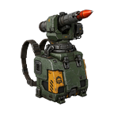

# WePlay: Personal Rocket Launcher Equipment

Armor equipment for Factorio 2.1 that automatically fires rockets at nearby enemies, using rockets from your inventory. 🚀

## Features

- A 3x3 armor equipment module, unlocked with **Rocketry**.
- Fires automatically at the nearest enemy in range.
- Uses any rocket ammo in your main inventory: regular rockets, explosive rockets, atomic bombs, and rockets from other mods.
- Loads the best rocket you're carrying first, using your **Rocket priority** setting. The loaded ammo's icon shows on the launcher in your armor grid.
- Range, damage and shooting speed show in the tooltip. Rocket damage and shooting speed research apply.
- Fire rate stacks: every extra launcher fires on its own.
- Doesn't use any energy from your armor grid. It only needs rockets.
- Press **Ctrl + Alt + R** to toggle it on or off. Loaded rockets go back into your inventory.

### Quality

Higher quality launchers get **+10% range** and **+30% damage** per quality level.

### ☢️ Atomic rockets

Atomic rockets are **off by default**. Turn on **Allow atomic rockets** in your per-player mod settings to use them. They won't fire at enemies closer than the **Atomic minimum range** (30 tiles by default).

### Space Exploration

Space Exploration's antimatter rockets count as atomic, so they stay behind the same toggle. Space Exploration is an optional dependency so its rockets are picked up correctly.

## Settings

| Setting | Type | Default |
|---|---|---|
| Targeting range | Startup | 30 |
| Cooldown (ticks) | Startup | 60 |
| Atomic minimum range | Startup | 30 |
| Allow atomic rockets | Per player | Off |
| Rocket priority | Per player | `atomic-bomb, explosive-rocket, rocket` |

Rocket priority is a comma-separated list of ammo item names, best first. Rocket types you don't list are used after the ones you do.

## Installation

Install it from the in-game mod manager, or download it from the [Factorio mod portal](https://mods.factorio.com/mod/WePlayRocketLauncherEquipment).

Requires Factorio 2.1. Space Age and Quality are optional.

## How it works

Each launcher is an `active-defense-equipment` with a 1 J buffer that never charges from the armor grid. The script loads a launcher by taking one rocket from the inventory and giving it 1 J, which is exactly one shot. At load time the mod makes a hidden copy of the launcher for every rocket ammo type and quality level, and swaps in the matching copy whenever it loads a rocket. This approach was inspired by the [Gun Equipment](https://mods.factorio.com/mod/GunEquipment) mod.

## More WePlay mods

See the rest of the WePlay mods on the [mod portal](https://mods.factorio.com/user/afewvowels).

## License

Released under [the Unlicense](LICENSE). The code is in the public domain, so use it however you like.
